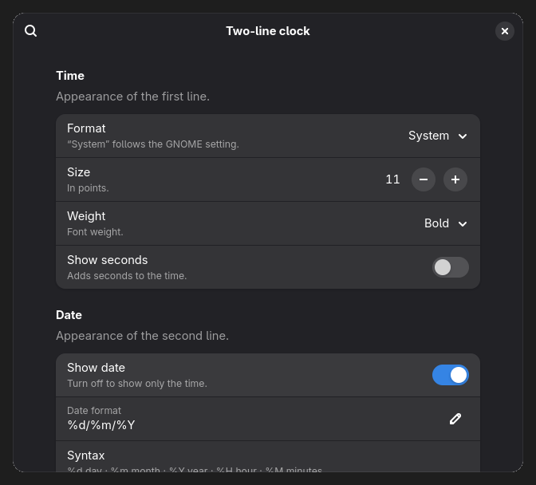
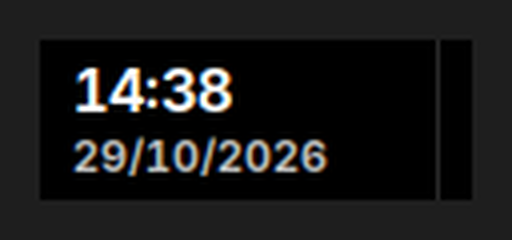

# Two-line clock

GNOME Shell extension that shows the **time and date on two lines** in the panel,
in the style of the Windows 11 clock:

```
14:01
29/10/2026
```

The time is larger and semibold; the date is smaller and dimmed.

*Read this in [Spanish](README.es.md).*

## Screenshots




## Features

- Two real lines rendered with a single `St.Label` (no containers that can break
  the layout across GNOME versions).
- **Preferences window**: sizes, weight, opacity, date format, seconds and clock
  format, without touching any code.
- Respects the system 12/24-hour setting, or can force either one.
- Clicking the clock still opens the GNOME calendar.
- Works with the default GNOME panel and with
  [Dash to Panel](https://extensions.gnome.org/extension/1160/dash-to-panel/),
  including multiple monitors.
- If anything fails, GNOME's original clock stays visible: the extension only
  hides it while it is working.

## Requirements

- GNOME Shell 46 – 51.
- No runtime dependencies.
- To build or install from source: `glib-compile-schemas` (package `glib2-devel`
  on Fedora) and `msgfmt` (package `gettext`). The release zip already includes
  the compiled files.

## Installation

### From the repository

```bash
git clone https://github.com/alexis900/two-line-clock.git
cd two-line-clock
./build.sh install
```

GNOME Shell does not discover new extensions until the next login. Then:

```bash
./build.sh enable    # or: gnome-extensions enable two-line-clock@alexis900.github.io
```

**Log out and back in** the first time. Later code updates also require a
session restart: GNOME caches extension JavaScript and `ReloadExtension` is not
implemented in GNOME 51.

### Manual installation

```bash
./build.sh pack
gnome-extensions install --force dist/two-line-clock@alexis900.github.io.shell-extension.zip
```

### From the release (no git)

Download the `.zip` from the latest
[release](https://github.com/alexis900/two-line-clock/releases/latest) and run:

```bash
gnome-extensions install --force two-line-clock@alexis900.github.io.shell-extension.zip
```

## Uninstallation

```bash
./build.sh uninstall
```

## Settings

Open the extension preferences:

```bash
gnome-extensions prefs two-line-clock@alexis900.github.io
```

Or use GNOME's **Extensions** app and click the settings button next to
“Two-line clock”. Available options:

| Setting | Default |
| --- | --- |
| Clock format (system / 24-hour / 12-hour) | system |
| Show seconds | off |
| Time size | 11 pt |
| Time weight | semibold |
| Show date | on |
| Date format | `%d/%m/%Y` |
| Date size | 8 pt |
| Date opacity | 75 % |

The date format follows
[GLib.DateTime.format](https://docs.gtk.org/glib/method.DateTime.format.html)
syntax: `%d` day, `%m` month, `%Y` year, `%H` hour, `%M` minutes, `%A` weekday.

Values can also be changed from the command line:

```bash
gsettings --schemadir ~/.local/share/gnome-shell/extensions/two-line-clock@alexis900.github.io/schemas \
  set org.gnome.shell.extensions.two-line-clock time-font-size 12
```

The **About** section shows the extension version and the commit it was built
from, with a link to that commit on GitHub.

The panel must be tall enough for two lines (40 px works well).

## Structure

```
extension.js    Extension code
prefs.js        Preferences window
schemas/        GSettings schema with the settings
po/             Translations (Spanish included)
metadata.json   Metadata (uuid, supported GNOME versions)
build.sh        Packaging, installation and uninstallation
```

## Translations

Source strings are in English. To add a language, create `po/<lang>.po` (you can
start from `po/two-line-clock.pot`) and run `./build.sh pack`; the compiled
catalogue is included automatically.

To refresh the template after changing strings:

```bash
xgettext --language=JavaScript --from-code=UTF-8 --keyword=_ \
  --package-name=two-line-clock -o po/two-line-clock.pot prefs.js
```

## Compatibility notes

- **GNOME 51**: `St.BoxLayout` no longer accepts a `vertical` property, and its
  vertical orientation did not apply reliably, so both lines are drawn with
  Pango markup inside a single `St.Label`.
- The panel size is not controlled by this extension. With Dash to Panel, set
  `panel-size` and clear `panel-sizes` if a per-monitor value overrides it.

## License

GPL-2.0-or-later. See [LICENSE](LICENSE).
